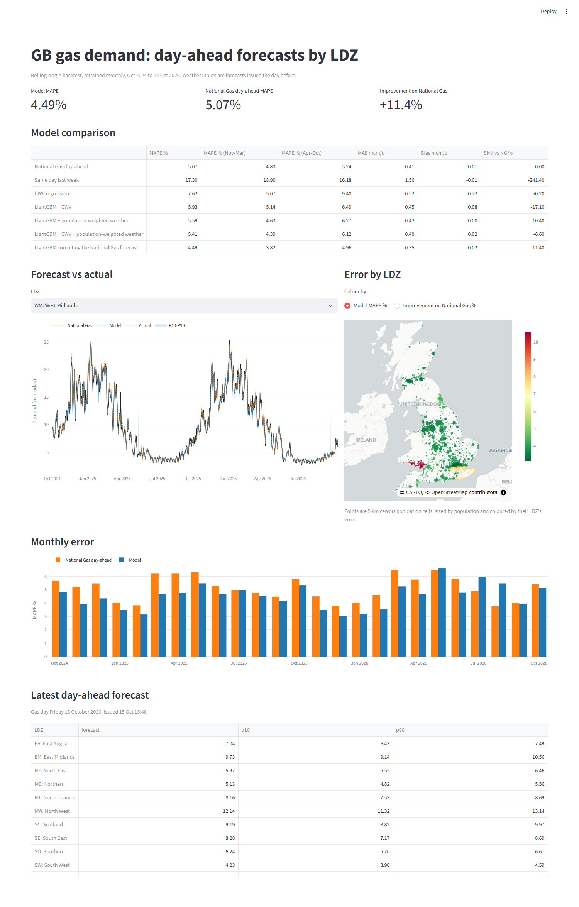

# GB-Gas-Demand-Forecast

Day-ahead gas demand forecasts for the 13 Local Distribution Zones (LDZs) of Great Britain's gas
network, using population-weighted weather and an MLOps workflow (MLflow tracking, model registry,
scheduled forecasting), benchmarked against National Gas's own day-ahead forecast.



## Results

Rolling-origin backtest, October 2024 to October 2026 (two winters, 9,453 LDZ-days), every model
retrained monthly and using only information available at 14:00 on the day before. Lower is better.

| Model | MAPE | Winter (Nov-Mar) | Summer | vs National Gas |
| --- | --- | --- | --- | --- |
| National Gas day-ahead forecast (benchmark) | 5.07% | 4.83% | 5.24% | |
| Same day last week | 17.30% | 18.90% | 16.18% | -241% |
| CWV regression (traditional) | 7.62% | 5.07% | 9.40% | -50% |
| LightGBM + National Gas CWV | 5.93% | 5.14% | 6.49% | -17% |
| LightGBM + population-weighted weather | 5.59% | 4.63% | 6.27% | -10% |
| LightGBM + CWV + population-weighted weather | 5.41% | 4.39% | 6.12% | -7% |
| **LightGBM correcting the National Gas forecast** | **4.49%** | **3.82%** | **4.96%** | **+11.4%** |

- **Population-weighted weather beats the operator's own weather variable as a model input** (5.59%
  vs 5.93%), and in winter, without seeing National Gas's forecast at all, it already beats it (4.63%
  vs 4.83%).
- **The champion learns National Gas's systematic errors** from its published day-ahead forecast
  together with the weather, lags and calendar: 11% lower error overall, 21% lower in winter, and better
  in 12 of 13 LDZs. The exception is Wales South, where the published actuals themselves drift.
- **The P10-P90 range covers 81.6% of days** (target 80%) after conformal calibration; uncalibrated
  quantile models covered only 67%.

## Data quality findings

The published "actual" demand is not always right, and scoring against it without checks would reward
the wrong model:

- **Placeholder values** repeated for days (e.g. 3.7 mcm in SO, 14.6 in WM) and D+6 closeouts near
  zero or negative while the D+1 value is fine: 115 days use the D+1 value, 181 are flagged.
- **A year-long under-reading in South East**, September 2022 to mid 2023: published actuals 20-45% below
  both the weather-expected level and National Gas's own forecast, then back to normal. A 4-week rolling
  comparison with the operator's forecast flags 473 such days (SE, and WS since late 2025).
- **Broken benchmark values**: six National Gas day-ahead forecasts were published as 0 (or far off).
  They are treated as missing, so the correction model falls back on its other inputs rather than
  trusting them; on 14 December 2025 that is the difference between forecasting 9.4 and about 19
  mcm/day in North West.

## Why this project

Gas demand in an LDZ is mostly heating, and heating follows the weather where people live. National
Gas publishes, for every LDZ and gas day, the actual demand, its own forecasts and the Composite
Weather Variable (CWV) it forecasts with. That makes it possible to build a model and score it honestly
against the operator, day by day, on the same information that was available at the time.

## What it does

1. **Data** (`scripts/01_download_nationalgas.py`). Five years of LDZ demand, National Gas forecasts
   (every published version) and CWVs from the National Gas Data Portal API. Raw monthly files are
   archived because the portal keeps only about five years.
2. **Data quality** (`src/gasfc/quality.py`). Published actuals are not always right. Two values exist
   per day (first at D+1, closed out at D+6). Each is checked against the demand expected for the day's
   weather; the closed-out value is used when plausible, then the first. Sustained drifts from the
   operator's own forecast (weeks of under-reading) are flagged too. Flagged days are excluded from
   training and from scoring, for every model alike.
3. **Population-weighted weather** (`scripts/02_population_cells.py`, `scripts/03_weather.py`). Census
   2021/2022 population at 41.6M address points ([GB-Census-Population-Map](https://github.com/petersolan/GB-Census-Population-Map))
   is summed into 5 km cells, assigned to LDZs, and clustered (population-weighted k-means) into three
   weather points per LDZ. Hourly Open-Meteo weather at those points is aggregated over the gas day
   (05:00 to 05:00 UK time) and weighted by the share of the LDZ's people each point represents.
4. **Models** (`src/gasfc/models.py`). From a naive baseline, through the traditional CWV regression,
   to one LightGBM model across all LDZs (demand scaled by each LDZ's level, recent years weighted
   more), with a P10-P90 range from quantile models widened by conformal calibration.
5. **Backtest** (`scripts/04_backtest.py`). Rolling origin: retrained every month on everything before
   it, forecasting that month, from October 2024. Every run is logged to MLflow.
6. **Deployment** (`scripts/05_train_register.py`, `scripts/06_forecast.py`). The champion model is
   registered in the MLflow Model Registry; the daily job loads it by alias and forecasts tomorrow.
7. **Dashboard** (`app/dashboard.py`). Streamlit: model comparison, forecast vs actual with the
   P10-P90 range, an error map, monthly error and the latest forecast.

## Being fair to the benchmark

- **Forecast time is 14:00 on the day before.** At that point the latest published actual is for two
  days earlier, so demand lags start at two days, using the value that was published then (D+1), not the
  later closeout. A test checks this.
- **Weather inputs are forecasts made the day before.** Open-Meteo's Previous Runs API keeps what each
  forecast said one day ahead from February 2024. The test period (October 2024 onwards) uses only those;
  earlier training years use same-day weather, the best available.
- **National Gas's benchmark is its day-ahead forecast**: the latest version issued before 14:00 on
  the day before, not the final within-day revision.

## Approximations

- **LDZ boundaries** are not published as open data. Local authorities are assigned to LDZs by region,
  with county-level splits where LDZs cross regions (`src/gasfc/geography.py`). This only steers where
  weather is sampled; the weights come from where people live.
- **Weather points**: three per LDZ keep the free Open-Meteo quota manageable; more points would
  sample large LDZs (Scotland, South West) more finely.
- **Test period**: two winters with genuine day-before weather forecasts. Earlier years are training
  only, because the archive of day-before forecasts starts in February 2024.

## Next steps

- Daily forecasts are appended to `data/processed/forecasts.parquet`; scoring them as actuals arrive
  would turn the backtest into live monitoring, with an alert when error drifts.
- Schedule `06_forecast.py` (cron, GitHub Actions or Azure ML pipelines) and promote a new champion
  only when it beats the current one on the latest months.
- More weather points per LDZ, and a peak-day view (the 1-in-20 cold day matters most for planning).

## Run it

```bash
conda env create -f environment.yml
conda activate gasfc
pip install -e .

python scripts/01_download_nationalgas.py      # National Gas data, quality checks
python scripts/02_population_cells.py          # optional: needs GB-Census-Population-Map outputs
python scripts/03_weather.py                   # weather points (committed in reference/) + Open-Meteo
python scripts/04_backtest.py                  # rolling backtest, logged to MLflow
python scripts/05_train_register.py            # train and register the champion
python scripts/06_forecast.py                  # tomorrow's forecast with the champion

mlflow ui --backend-store-uri sqlite:///mlflow.db
streamlit run app/dashboard.py
pytest
```

Without the census outputs, `03_weather.py` uses the committed `reference/weather_points.csv`.

## Data sources

- [National Gas Data Portal](https://data.nationalgas.com/find-gas-data): LDZ demand, forecasts and
  CWVs (National Gas Transmission).
- [Open-Meteo Previous Runs API](https://open-meteo.com/en/docs/previous-runs-api): hourly temperature,
  wind and solar radiation, CC BY 4.0.
- Census 2021 (ONS, NRS for Scotland 2022) and ONSUD address locations, via GB-Census-Population-Map.
